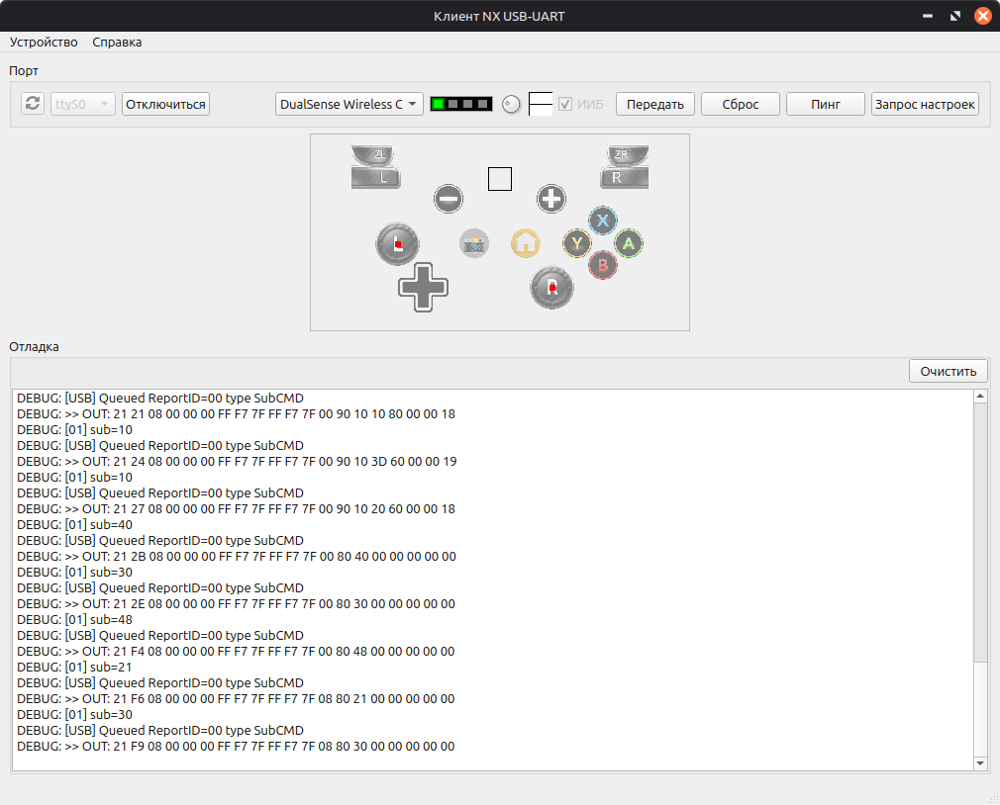

# UART-клиент для адаптера игрового управления USB-HID через RS232 для Nintendo® Switch™ и Switch 2™

Программа-клиент для взаимодействия с самодельным устройством, которое позволяет управлять консолями Nintendo Switch, имитируя протокол USB-HID совместимый с контроллерами Nintendo Switch Pro.

Информация об устройстве, совместимая прошивка и о том, как его создать, [имеется отдельный репозиторий](/Wohlstand/NXUSB-STM32-Firmware).

Данный проект выпущен под [лиценией MIT](LICENSE.txt).

# Как собрать
Сам проект использует Qt и SDL2. Разработано и протестировано на Linux и Windows, на macOS не тестировалось, но в теории должно работать без проблем.

## Требования
- Qt 5 или Qt 6, обязательны компоненты Core, Gui, Widgets и SerialPort.
- SDL2 (можно собрать из исходников https://github.com/libsdl-org/SDL/tree/SDL2) или SDL3:
  - Клонировать репозиторий так из ветки `SDL2`: `git clone https://github.com/libsdl-org/SDL.git -b SDL2 SDL2`
- Компилятор совместимый со стандартом C++17.
- CMake 3.16 и новее.

# Описание интерфейса

- **Верхний ряд кнопок**:
  - Кнопка обновления списка портов (если Вы вдруг подключили или отключили USB-UART во время работы программы, надо освежить список).
  - Список доступных портов. Здесь Вы выбираете порт, с которым работать.
  - Кнопка подключения/отключения - подключиться к UART-адаптеру и запустить обработку физических геймпадов.
  - Список подключённых физических геймпадов (активен только во время подключения).
  - Индикатор игрока. Количество сегментов означает номер игрока.
  - Регулятор силы вибрации. Иногда геймпад может вибрировать слишком сильно, и потому эту вибрацию можно отрегулировать.
  - Индикатор вибрации. Отображает волны активной вибрации, данные которой прилетают от консоли.
  - Индикатор Инерциального Измерительного Блока (ИИБ), активен ли он или нет. Если активен, то на консоль будет передаваться состояние гироскопа и акселерометра (если они у него есть).
  - Кнопка принудительной передачи текущего состояния, даже когда оно не изменилось. Полезно для некоторых отладок.
  - Кнопка сброса - перезагрузит USB-устройство на микроконтроллере.
  - Кнопка Пинга - проверка связи с микроконтроллером.
  - Кнопка запроса настроек - позволяет скорректировать текущее отображение если оно вдруг некорректное.
- **Состояние игрового контроллера.** Отображение состояния кнопок, джойстиков, акселерометра и гироскопа (вращающийся трёхмерный кубик).
- **Отладочный вывод**
  - Кнопка очистки вывода - стирает всё, что было выведено в данной области.

Прежде чем начать работу, необходимо выбрать порт, который соответствует UART-адаптеру. Если это USB-UART, то от может отображаться как ttyUSB0 на Linux, либо как один из COM-портов на Windows. Если адаптер подключён, а в списке его нет, попробуте обновить список кнопкой слева. Если он всё равно не появился, вероятно он подключен неправильно, либо не хватает драйверов в системе.

Как только нужный адаптер будет выбран, необходимо нажать кнопку "Подключиться". Подключиться можно и до запуска самого микроконтроллера, чтобы наблюдать полный цикл его запуска в отладочном окне ниже.

Также необходимо выбрать правильный геймпад, который и будет управлять устройством.

По завершении работы, необходимо сначала отключить, нажав на кнопку "Отключиться", и затем можно будет закрыть окно.

## Возможные проблемы и способы их решения:
Иногда могут возникать ошибки, либо странности поведения, и я привожу некоторые из них:

### Гироскоп всё время крутит влево/вправо
Так называемый "эффект микроволновки". Его можно исправить просто положив физический геймпад на стол. Если же это не помогает, то можно попробовать нажать кнопку "сборса", передачи состояния и попытаться отключиться/подключиться и повторить попытку с лежанием геймпада на столе.

### Мусор в отладочном окне, много ошибок формата "invalid reply"
Это признак нарушения стабильности связи, например, при работе через MAX3232, если ему не хватает питания. При работе через USB-UART таких проблем обычно возникать не должно.
